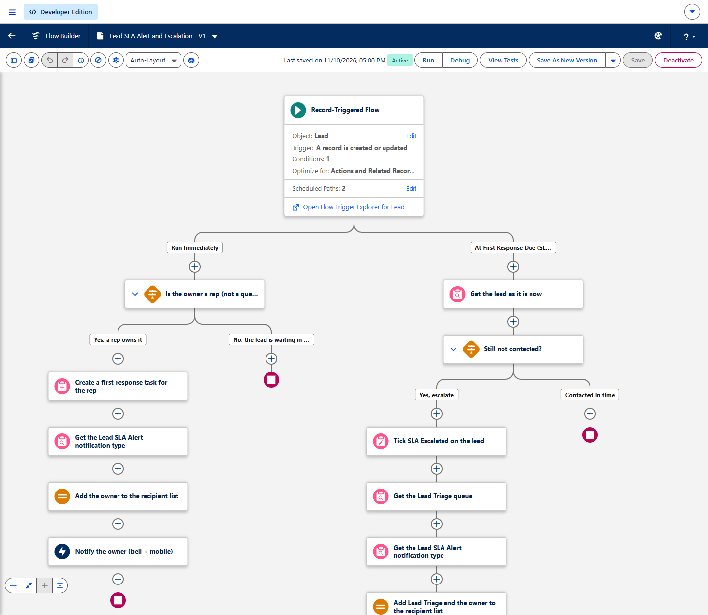
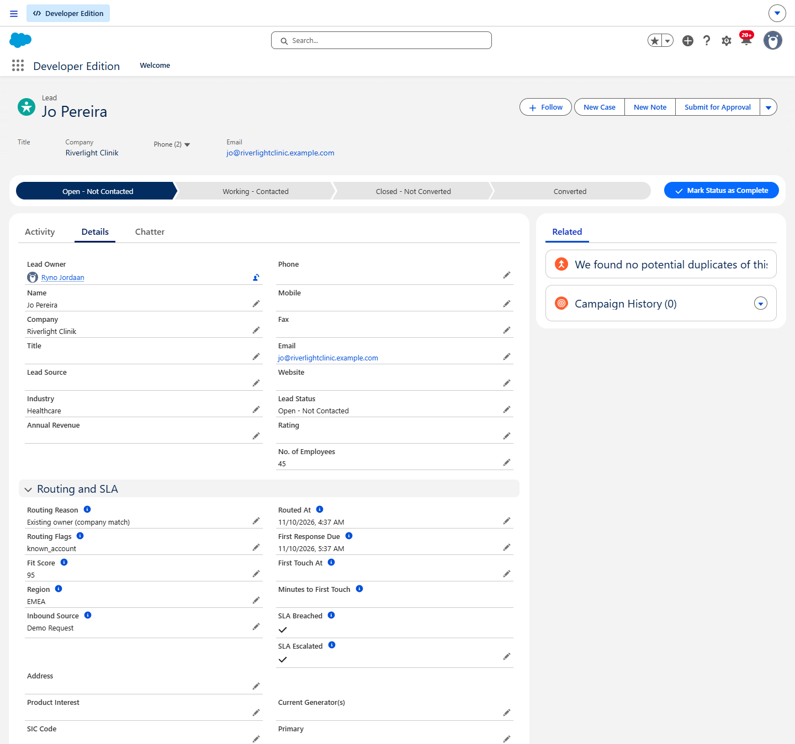
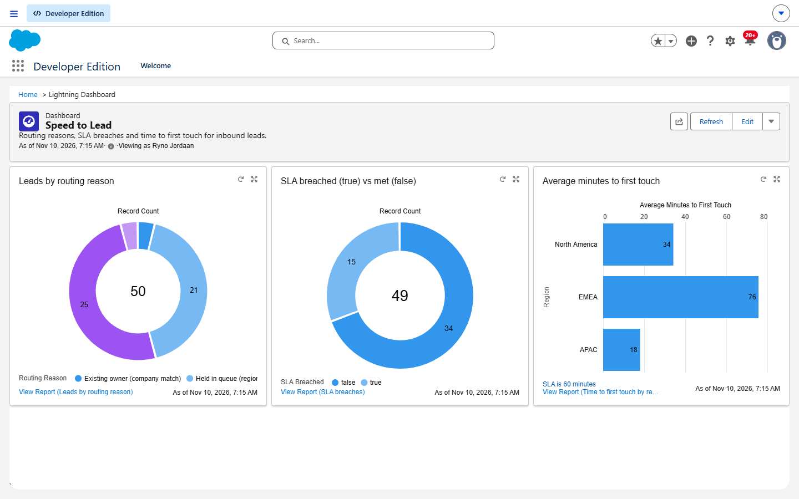
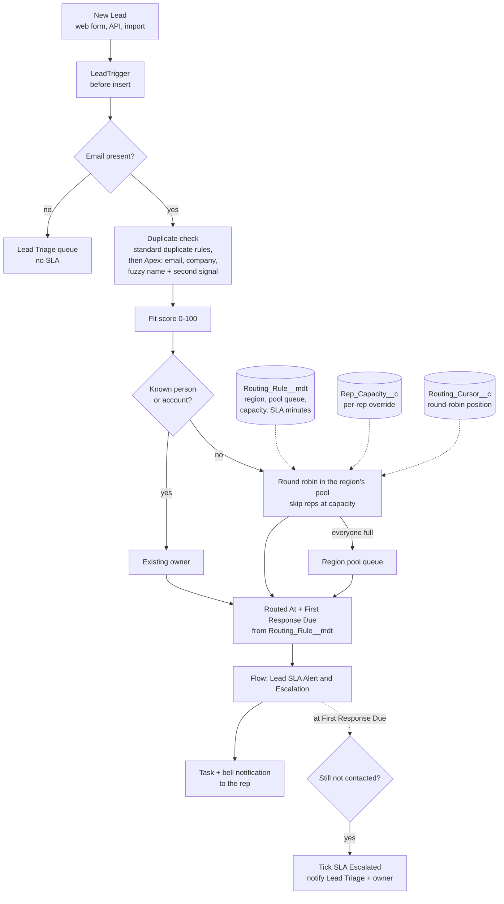

# Salesforce lead routing

**200 leads routed in one transaction in about 0.8 s (5 SOQL queries, whatever the batch size). 29 Apex tests pass, 98% code coverage. Deployed and run in a Salesforce Developer Edition org.**

This is speed-to-lead routing built natively in Salesforce: an Apex trigger service, custom
metadata for the rules, a record-triggered Flow for the SLA alerts, and a report dashboard. It is
the third version of the same routing logic. The first is a Python router in the
[Revenue Leak Engine](https://github.com/RynoJor/revenue-leak-engine) (about 8 ms per lead). The
second is an n8n workflow (about 160 ms per lead over HTTP). The comparison is further down.

All data is synthetic. Every email address is on `example.com`.

## Results from the org

| | |
|---|---|
| Apex tests | 29 test methods, all pass (the CLI summary says 30 because it also counts the `@TestSetup` method) |
| Code coverage | 98% org-wide (LeadRoutingService 98%, LeadDuplicateMatcher 98%, LeadTriggerHandler 92%, LeadFitScorer, RoundRobinAssigner and LeadTrigger 100%) |
| 200 leads in one insert: routing | 814 ms median of 5 runs (716 to 959 ms), 5 SOQL queries |
| 200 leads in one insert: whole save | about 3.4 s, including duplicate rules, the Flow and the first-response tasks |
| 1 lead: routing / whole save | 190 ms / 375 ms, median of 5 runs |
| Bulk test in the test suite | 200 leads in one trigger call, at most 10 queries asserted, NA split 50/50 across two reps |

Timings come from [`scripts/apex/bulk-benchmark.apex`](scripts/apex/bulk-benchmark.apex). It
inserts 200 leads, reads the timing the service records, then rolls the whole transaction back.
Most of the routing time is fixed cost (the duplicate-rule lookup and five queries), which is why
one lead takes 190 ms and 200 leads take about 800 ms.

The 50 seed leads in [`data/leads.json`](data/leads.json) routed like this:

| Routing reason | Leads |
|---|---|
| Round robin | 25 |
| Held in queue (region at capacity) | 21 |
| Existing owner (company match) | 2 (`Brightpath Tutoring Ltd` matched `Brightpath Tutoring`; `Riverlight Clinik` matched `Riverlight Clinic` with the same email domain) |
| Existing owner (email match) | 1 (same address, different case) |
| Not routed: missing email | 1, sent to the Lead Triage queue |

`Silverlight Clinic` has a name close to `Riverlight Clinic` but nothing else in common, so it is
treated as a new business. The two LATAM leads and the lead with no region fell back to the
Default rule and are flagged `unknown_region` or `missing_region`. The org has one user who can own
leads (see Limits), so after 25 open leads that rep is full and later leads wait in their region's
queue, which is why 21 are held.

## Screenshots

The SLA Flow on the Flow Builder canvas:



A routed lead. The company name has a typo, the email domain matches an existing account, so the
lead went to that account's owner. Nobody touched it within 60 minutes, so the Flow ticked SLA
Escalated:



The Speed to Lead dashboard:



The first-touch times on the dashboard are simulated.
[`scripts/apex/simulate-first-touch.apex`](scripts/apex/simulate-first-touch.apex) moves the seed
leads' routing time back three hours and marks 18 of them contacted after 3 to 140 minutes. The
10 it leaves untouched were then escalated by the Flow's scheduled path in the org, with no
further action from me.

## How it works



| Step | What it does |
|---|---|
| Validate | A lead with no email cannot be worked, so it goes to the Lead Triage queue with no SLA clock. The lead is kept, not rejected. Salesforce already rejects a malformed email on save. A missing region or source is flagged and routing carries on |
| Duplicate check | First `Datacloud.FindDuplicates` runs the org's active Lead duplicate rules, 50 records per call. Then the Apex rules from the Python router: exact email (case-insensitive) is `duplicate_contact`; the same company after normalising (case, punctuation, legal suffixes) is `known_account`; a similar company name (Levenshtein ratio 0.85 or more) is `known_account` only if the contact surname or business email domain also matches. Public mail domains never count. One query loads every candidate, and leads earlier in the same batch are matched too |
| Fit score | 0 to 100: inbound source (demo request 35 down to content download 10), company size, core industry (Healthcare, Recreation, Consulting), business email. Same points as the Python and n8n versions |
| Assign | A duplicate goes to the existing owner if that user is active. Otherwise round robin through the active users in the region's pool queue, sorted by Id, skipping anyone whose open leads (`Open - Not Contacted` or `Working - Contacted`) have reached their capacity. If every rep is full, the lead waits in the region's queue, flagged `over_capacity`. A region with no rule uses the Default rule, flagged `unknown_region` |
| SLA | `Routed_At__c` is now; `First_Response_Due__c` is now plus the rule's SLA minutes (60) |
| First touch | When Status first moves off `Open - Not Contacted`, the trigger stamps `First_Touch_At__c` |

## What is deployed

| Type | Name | Purpose |
|---|---|---|
| Custom fields on Lead | `Fit_Score__c`, `Routing_Reason__c`, `Routing_Flags__c`, `Routed_At__c`, `First_Response_Due__c`, `First_Touch_At__c`, `SLA_Escalated__c` | Routing output and the SLA clock |
| | `Region__c`, `Inbound_Source__c` (picklists) | Inputs from the form |
| | `Company_Key__c`, `Email_Domain__c` (indexed text) | Keys for the duplicate check, set by the trigger |
| | `Minutes_To_First_Touch__c`, `SLA_Breached__c` (formulas) | For the reports |
| Custom metadata type | `Routing_Rule__mdt` with records North_America, EMEA, APAC, Default | Region, pool queue, max open leads per rep, SLA minutes, active |
| Custom settings | `Rep_Capacity__c` (hierarchy), `Routing_Cursor__c` (list) | Per-rep capacity override; round-robin position per rule |
| Queues | Lead Pool - North America / EMEA / APAC, Lead Triage | Rep pools (the members are the reps); triage for missing data and escalations |
| Apex | `LeadTrigger`, `LeadTriggerHandler`, `LeadRoutingService`, `LeadDuplicateMatcher`, `LeadFitScorer`, `RoundRobinAssigner` | The routing logic |
| Apex tests | `LeadRoutingServiceTest` (17), `LeadDuplicateMatcherTest` (6), `LeadFitScorerTest` (3), `RoundRobinAssignerTest` (3) | 29 tests |
| Flow | `Lead_SLA_Alert` (record-triggered, after save, with a scheduled path) | Task and notification to the rep; escalation at the due time |
| Custom notification type | `Lead_SLA_Alert` | Bell and mobile alerts |
| Duplicate management | Matching rule `Routing_Exact_Email`, duplicate rule `Routing_Same_Email` | Exact-email match, report only |
| Reports and dashboard | Leads by routing reason, SLA breaches, Time to first touch by region; dashboard Speed to Lead | In the Lead Routing folders |
| Layout and list view | "Routing and SLA" section on the Lead layout; Routed Leads list view | So reps see why they got the lead |
| Permission set | `Lead_Routing` | Field access for the routing fields |

## Deploy it

You need the Salesforce CLI (`npm install -g @salesforce/cli`) and an org: a free Developer
Edition from developer.salesforce.com/signup works.

```bash
sf org login web --alias my-org
```

```bash
sf project deploy start --target-org my-org
```

```bash
sf org assign permset --name Lead_Routing --target-org my-org
```

```bash
sf apex run --file scripts/apex/setup-demo.apex --target-org my-org
```

`setup-demo.apex` adds you to the four queues so the pools have a rep. In a real org, add your
reps to the pool queues in Setup instead.

```bash
sf apex run test --target-org my-org --code-coverage --result-format human --test-level RunLocalTests
```

```bash
sf data import tree --files data/leads.json --target-org my-org
```

```bash
sf apex run --file scripts/apex/bulk-benchmark.apex --target-org my-org
```

To change routing, edit the Routing Rule records in Setup → Custom Metadata Types. No deploy of
Apex is needed. `python scripts/make_seed.py` rebuilds the seed file.

## Design decisions

- **Rules in custom metadata, not code.** Region to pool queue, capacity and SLA minutes are
  `Routing_Rule__mdt` records. Admins change them in Setup, they deploy with the code, and Apex
  reads them from the metadata cache with no SOQL. The reps are whoever is in the pool queue, so
  adding a rep is a queue membership change.
- **Bulk-safe trigger.** One trigger on Lead, before insert and before update only, so the owner
  and routing fields are set in memory with no extra DML on the leads and no recursion. The
  service runs a fixed set of queries (pool queues with members, duplicate candidates, active
  users, open-lead counts, round-robin cursors) and one upsert, whatever the batch size. The
  round-robin and capacity logic is a plain class with no database access, tested on its own.
- **Round-robin position is locked.** The cursor rows are read `FOR UPDATE`, so two inserts at
  the same moment queue up instead of giving the same rep the same slot.
- **Apex for logic, Flow for the human-facing SLA.** The routing decision needs bulk-safe queries
  and fuzzy matching, which belong in tested Apex. The task, the notification and the timed
  escalation are what an admin is most likely to change (wording, recipients, timing), so they
  live in a Flow an admin can read and edit. The Flow's scheduled path runs at
  `First_Response_Due__c`, so the SLA length is set once, in the routing rule.
- **Standard duplicate rules first, Apex second.** `Datacloud.FindDuplicates` uses whatever Lead
  duplicate rules the org has switched on. The Apex check then applies the stricter
  second-signal rule, and it still works if an admin turns the duplicate rules off.
- **`without sharing` on purpose.** The duplicate check and rep loads must see every lead, not
  only those visible to whoever inserted it (a web form's guest user, an integration user).
- **Never leave a lead unowned.** No email goes to Triage; a full region waits in its own queue;
  no rule at all goes to Triage. Every case gets a `Routing_Reason__c` that a report can group by.

## Python vs n8n vs Salesforce

| | Python ([revenue-leak-engine/router](https://github.com/RynoJor/revenue-leak-engine)) | n8n | Salesforce (this repo) |
|---|---|---|---|
| Time to route one lead | about 8 ms (in process) | about 160 ms (HTTP in to response out) | 190 ms routing, 375 ms whole save |
| Batch | one lead at a time | one lead per webhook call | 200 per transaction in about 0.8 s |
| Where the rules live | Python constants | Code node constants and a Set node | Custom metadata records |
| Where state lives | CSV in memory | Workflow static data | Lead records, queue membership, custom settings |
| Duplicate check | email, company, fuzzy name + second signal (difflib) | same rules in JavaScript | standard duplicate rules, then the same rules in Apex (Levenshtein) |
| Alert | Slack webhook or print | Slack node or log file | Task, bell and mobile notification, timed escalation |
| SLA follow-up | not built | not built | Flow scheduled path at the due time |
| Tests | 18 pytest tests | replay script | 29 Apex tests, 98% coverage |
| Pick it when | routing sits in your own service or data pipeline | you need glue between several SaaS tools fast, without a server | the CRM is Salesforce and reps live in it |

The timings are not like for like. Python runs in one process with the data in memory. n8n
includes an HTTP round trip and node hand-offs. Salesforce includes the database writes, the
duplicate rules, the trigger and the Flow. In Salesforce the lead is already in the CRM with an
owner and a task when the save returns, which the other two still have to do.

## Limits

- **One rep in the demo org.** A Developer Edition org has two full Salesforce licences, and one
  is the admin, so the live pools hold a single rep (me). Round robin across several reps,
  capacity skips and the 50/50 split are shown in the Apex tests, which create three test users
  and their own queues.
- **First-touch times are simulated** by a script, as described under the dashboard.
- **Capacity counts all of a rep's open leads**, across regions. Working hours, time zones and
  out-of-office are not considered.
- **Lead assignment rules override the owner.** If leads arrive with the assignment-rule header
  (Web-to-Lead with an active assignment rule, or an API client that sets it), the assignment
  rule runs after this trigger and changes the owner. Switch the assignment rule off for routed
  sources.
- **The org's own duplicate rules count.** `FindDuplicates` uses every active Lead duplicate rule.
  The standard rule's fuzzy name matching is looser than the Apex rule: in testing it matched two
  invented names with the same initials at similar companies. Switch it off if that matters.
- **A duplicate rule with an Alert action blocks API inserts** (DUPLICATES_DETECTED), even with
  action Allow. The routing rule is report-only for that reason.
- **Fuzzy matching** uses Levenshtein distance, not Python's difflib, so borderline names can
  score a little differently. The candidate query is capped at 5,000 leads; a very common surname
  in a large org would need a narrower blocking key.
- **The fit score points are in Apex** (`LeadFitScorer`), not in metadata. There is no enrichment
  step: industry and size come from the form.
- `SLA_Breached__c` uses `NOW()`, so an untouched lead flips to breached on its own when the due
  time passes. Custom notifications are limited to 10,000 per org per hour.

## Repo layout

```
force-app/main/default/   metadata and Apex (classes, triggers, flows, objects, reports, ...)
data/leads.json           50 synthetic leads for sf data import tree
scripts/make_seed.py      builds data/leads.json
scripts/apex/             setup-demo, bulk-benchmark, simulate-first-touch
docs/                     screenshots from the org
```

## Links

- Portfolio: https://rynojor.github.io
- Revenue Leak Engine (the Python router and the rest of the project): https://github.com/RynoJor/revenue-leak-engine
- LinkedIn: https://www.linkedin.com/in/ryno-jordaan/
